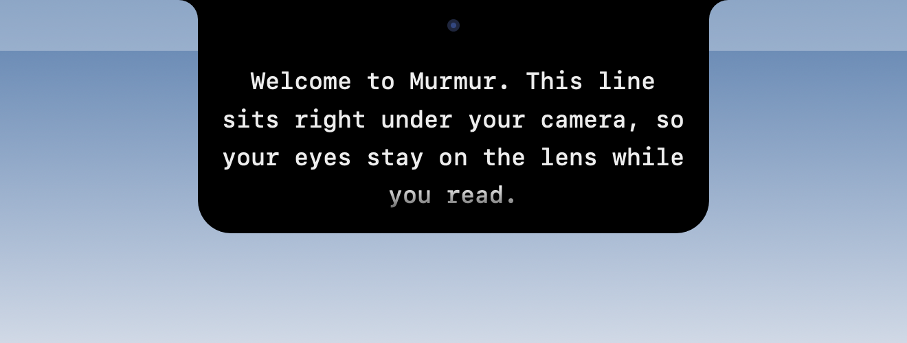
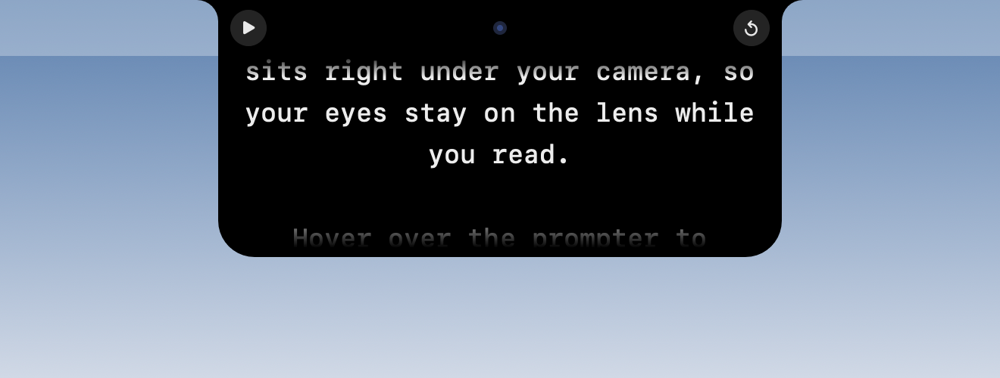
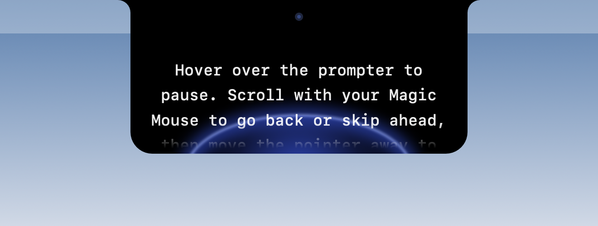
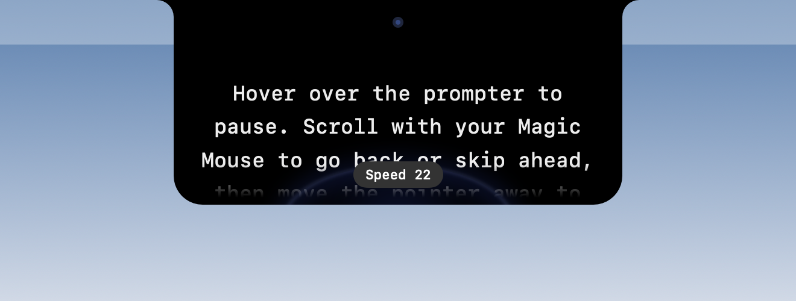
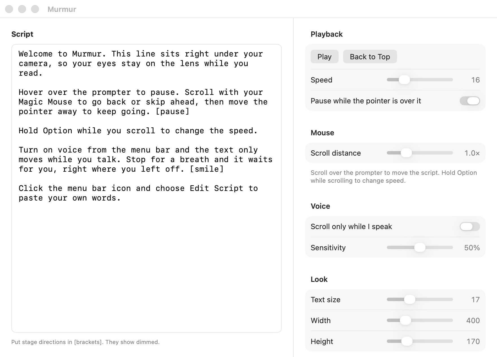

# Murmur

A teleprompter that hangs from the MacBook notch, right under the camera, so your eyes stay on
the lens while you read. In the style of [Moody](https://moodyteleprompter.com); a personal
project written from scratch in Swift and SwiftUI.



## What it does

- **Sits at the notch.** The prompter is drawn as an extension of the notch, sized to it. On
  screens without a notch it draws a stand-in at the top centre.
- **Pause on hover.** Move the pointer over it and it stops; move away and it carries on from
  the same line.
- **Scroll to steer.** Magic Mouse, trackpad or wheel moves you back or ahead.
  **Option + scroll** changes the speed.
- **Follows your voice.** With *Scroll Only While I Speak* on, the text moves while you talk,
  eases to a stop when you pause, and waits. Audio never leaves your Mac.
- **Hidden from screen sharing and recordings** by default, so your audience never sees it.
- **Stage directions** in `[brackets]` show dimmed, so you see them but don't read them out.

## Screenshots

| Reading | Hover to pause |
|---|---|
|  |  |
| **Speaking** — the blue beam shows your mic level | **Option + scroll** — speed toast |
|  |  |

**Edit Script** — paste your script and tune playback, mouse, voice and look. Every change
saves straight away.



## Requirements

- macOS 14 Sonoma or later (a MacBook with a notch is best, but any screen works)
- Swift 6 toolchain: the Xcode **Command Line Tools** are enough (`xcode-select --install`);
  full Xcode is not needed

## Get started

```bash
git clone https://github.com/Rakshitkeswani1210/Murmur.git
cd Murmur
scripts/run.sh
```

`scripts/run.sh` builds `build/Murmur.app` and launches it. Murmur lives in the menu bar as a
mic icon (no Dock icon); everything below starts from there. The first time you turn on voice, macOS asks for microphone access.

> The app is ad-hoc signed, so macOS asks for microphone access again after each rebuild.
> To keep a copy, drag `build/Murmur.app` into `/Applications`.

## Using it

| Action | How |
|---|---|
| Play / pause | Menu bar → **Play**, or hover over the prompter |
| Go back or skip ahead | Scroll over the prompter |
| Change speed | **Option + scroll** over the prompter, or the Speed slider |
| Start over | Menu bar → **Back to Top**, or the ↺ button on hover |
| Voice-paced scrolling | Menu bar → **Scroll Only While I Speak** |
| Edit the script and settings | Menu bar → **Edit Script…** |
| Show / hide the prompter | Menu bar → **Hide Prompter** |
| Let screen sharing see it | Menu bar → untick **Hide from Screen Sharing** |

### Settings

All in the Edit Script window, saved automatically.

| Group | Setting | Range | Default |
|---|---|---|---|
| Playback | Speed (points per second) | 4–60 | 16 |
| Playback | Pause while the pointer is over it | on / off | on |
| Mouse | Scroll distance | 0.5×–2.5× | 1.0× |
| Voice | Scroll only while I speak | on / off | off |
| Voice | Sensitivity (0% needs a loud voice, 100% reacts to a whisper) | 0–100% | 50% |
| Look | Text size | 12–28 | 17 |
| Look | Width | 300–720 | 400 |
| Look | Height | 110–340 | 170 |

## Development

```bash
scripts/run.sh                  # build (release) and relaunch; extra args go to the app
CONFIG=debug scripts/run.sh     # same, debug build
scripts/build.sh [debug|release] # build build/Murmur.app only
scripts/test.sh                 # run the tests (works with only the Command Line Tools)
swift scripts/make-icon.swift   # redraw Resources/AppIcon.icns
```

Launch flags:

| Flag | What it does |
|---|---|
| `--allow-capture` | Keeps the prompter visible to screenshots and screen sharing |
| `--open-editor` | Opens the Edit Script window on launch |
| `--snapshot <folder>` | Renders the prompter's states to PNGs and quits |

For example, `scripts/run.sh --allow-capture --open-editor`.

### Updating the screenshots

The prompter images come from the app's own snapshot renderer:

```bash
scripts/build.sh
build/Murmur.app/Contents/MacOS/Murmur --snapshot docs/screenshots
```

The editor image is a window capture (`screencapture -l <window id>`) of the app launched with
`--allow-capture --open-editor`.

### Project layout

```
Sources/
  Murmur/main.swift             app entry point
  MurmurKit/
    AppDelegate.swift           menu bar item and app menus
    EditorWindow.swift          Edit Script window and settings
    Prompter.swift              scroll position, playback, hover and scroll holds
    PrompterSettings.swift      user settings, saved to UserDefaults
    PrompterView.swift          the prompter's look
    NotchGeometry.swift         notch size and shape per screen
    NotchPanel.swift            the window, Magic Mouse handling, frame clock
    ScrollInput.swift           turns wheel/trackpad events into script movement
    VoiceGate.swift             speech detection from mic level
    VoiceController.swift       microphone capture
    Snapshot.swift              --snapshot renderer
Tests/MurmurKitTests/           Swift Testing tests
Resources/                      Info.plist and app icon
scripts/                        build, run, test and icon scripts
docs/screenshots/               images used in this README
```

## Privacy

Voice mode only measures your microphone level on-device to tell when you are speaking. Nothing
is recorded, transcribed or sent anywhere. The prompter window uses
`NSWindow.sharingType = .none` so it stays out of screen shares and recordings unless you turn
that off.
